# ResearchForge

[](https://nextjs.org/)
[](https://fastapi.tiangolo.com/)
[](https://r3f.docs.pmnd.rs/)
[](https://python.org)
[](https://www.typescriptlang.org/)
[](LICENSE)

**ResearchForge** is an autonomous full-stack AI research platform that accelerates the scientific discovery lifecycle. From an open research question, ResearchForge autonomously searches peer-reviewed literature, isolates unaddressed research gaps, synthesizes falsifiable hypotheses, plans controlled experiments with explicit baselines, generates isolated Python benchmark code, executes runs on serverless compute, captures telemetry and quantitative metrics, subjects results to adversarial peer critique, and writes evidence-grounded reports with verified source citations.

---

## Architecture Overview

```mermaid
flowchart LR
    A[Question Input] --> B[1. Evidence Search\nTavily API]
    B --> C[2. Gap Analysis\nNVIDIA Nemotron]
    C --> D[3. Hypothesis Design\nVariables & Baselines]
    D --> E[4. Code Generation\nAST Security Validated]
    E --> F[5. Serverless Execution\nNebius AI / Isolated Demo]
    F --> G[6. Telemetry & Metrics\nOutput Grounding]
    G --> H[7. Adversarial Critique\nThreats to Validity]
    H --> I[8. Structured Report\nPreserved Citations]
    I --> J[9. Reproducibility Bundle\nExport .md / .json]
```



### Subsystems

1. **Evidence Collection (`backend/app/services/tavily.py`)**:
   - Queries scientific web indices using Tavily Search API.
   - Normalizes, deduplicates, and preserves all title, URL, source domain, and snippet citations.
2. **Research Gap Synthesis (`backend/app/services/research_gap.py`)**:
   - Leverages NVIDIA Nemotron to identify consensus findings, conflicting claims, methodology limitations, and concrete open gaps.
   - Computes empirical confidence scores and qualitative justifications.
3. **Hypothesis & Experiment Planning (`backend/app/services/experiment_plan.py`)**:
   - Synthesizes falsifiable hypotheses.
   - Enforces explicit baselines, independent/dependent variables, controls, dataset requirements, and measurable evaluation metrics.
4. **Experiment Code Generation (`backend/app/services/experiment_code.py`)**:
   - Produces reproducible, single-file Python scripts with fixed random seeds (`RANDOM_SEED = 42`).
   - Hardened with an **AST Static Security Analyzer** that prevents access to host environments (`subprocess`, `socket`, `shutil`, `urllib`, `requests`, `eval`, `exec`, `os.environ`, `os.system`).
   - Automatically injects standard `METRIC key=value` telemetry lines for automated outcome parsing.
5. **Experiment Execution Service (`backend/app/services/experiment_execution.py`)**:
   - **Live Cloud Mode**: Deploys containerized runs to **Nebius AI Cloud Serverless AI** jobs with results written to **Nebius Object Storage**.
   - **Simulated Demo Mode**: Executes scripts inside an isolated local sub-environment where all host secrets (`NVIDIA_API_KEY`, `NEBIUS_API_KEY`, `TAVILY_API_KEY`, storage keys) are scrubbed and output is bounded. Clearly tagged with `[DEMO MODE]` banners.
6. **Adversarial Critique (`backend/app/services/research_critic.py`)**:
   - Skeptical peer reviewer evaluating threats to validity, baseline quality, statistical significance, and confounding factors.
7. **Evidence-Grounded Report (`backend/app/services/research_report.py`)**:
   - Compiles a 13-section academic research report.
   - Verifies numerical grounding against actual execution output and maintains clickable citation links.
8. **Hybrid 3D Frontend (`frontend/`)**:
   - Interactive Three.js/React Three Fiber 3D research graph on a Midnight Navy canvas with cyan and violet accents.
   - Clickable nodes synchronized with inspectors, live activity logs, and an automated WebGL fallback for low-power devices.

---

## Technology Stack

- **Backend**: FastAPI 0.142, Python 3.12+, Pydantic v2, Uvicorn, HTTPX.
- **Frontend**: Next.js 16 (App Router with Turbopack), React 19, TypeScript 5.9, Vanilla CSS Design System.
- **3D Graphics**: Three.js, `@react-three/fiber`, `@react-three/drei`.
- **Inference Models**: NVIDIA Nemotron (`nvidia/nemotron-3-nano-omni-30b-a3b-reasoning` or `nvidia/nemotron-4-340b-instruct`) via Nebius Token Factory or NVIDIA NIM.
- **Evidence Retrieval**: Tavily Search API.
- **Execution**: Nebius AI Cloud Serverless AI or Isolated Sandboxed Demo Runner.

---

## Windows Setup & Installation

### Prerequisites

- Windows 10/11 with PowerShell
- Python 3.12+ (or Python 3.14 installed in PATH or virtual environment)
- Node.js 20+ and npm

### 1. Environment Configuration

Copy the example environment file:

```powershell
Copy-Item backend\.env.example backend\.env
```

Edit `backend\.env` with your API keys:

```env
# Inference Provider (NVIDIA NIM or Nebius Token Factory)
NEBIUS_API_KEY=nvapi-...
NEBIUS_BASE_URL=https://integrate.api.nvidia.com/v1/
NEBIUS_MODEL=nvidia/nemotron-3-nano-omni-30b-a3b-reasoning
REQUEST_TIMEOUT_SECONDS=60

# Tavily Evidence Search
TAVILY_API_KEY=tvly-...
TAVILY_MAX_RESULTS=5

# Optional: Nebius Serverless Compute (for live cloud execution)
NEBIUS_PROJECT_ID=
NEBIUS_SERVERLESS_BASE_URL=https://api.nebius.cloud
NEBIUS_RESULTS_BUCKET=
NEBIUS_STORAGE_ACCESS_KEY_ID=
NEBIUS_STORAGE_SECRET_KEY=
NEBIUS_STORAGE_REGION=

# Optional: Enable local simulated demo execution if cloud is unconfigured
EXPERIMENT_DEMO_MODE=false
```

### 2. Frontend Environment

The frontend includes `frontend/.env.local`:

```env
NEXT_PUBLIC_API_BASE_URL=/backend
```

Calls to `/backend/*` are automatically reverse-proxied by Next.js to `http://localhost:8000`.

---

## Launch Commands

Open two PowerShell windows:

### Terminal 1 — Start Backend (Port 8000)

```powershell
cd D:\ResearchForge\backend
.\.venv\Scripts\uvicorn.exe app.main:app --host 0.0.0.0 --port 8000 --reload
```

*Or from the workspace root:*
```powershell
.\backend\.venv\Scripts\uvicorn.exe app.main:app --app-dir backend --host 0.0.0.0 --port 8000 --reload
```

### Terminal 2 — Start Frontend (Port 3000)

```powershell
cd D:\ResearchForge\frontend
npm run dev
```

Visit [http://localhost:3000](http://localhost:3000) in your browser.

---

## Running Verification & Tests

### Backend Test Suite (49 Automated Tests)

Run all unit, integration, security, and pipeline tests:

```powershell
cd D:\ResearchForge\backend
.\.venv\Scripts\pytest.exe -v
```

### Frontend TypeScript Check

```powershell
cd D:\ResearchForge\frontend
npm run typecheck
```

### Frontend Production Build

```powershell
cd D:\ResearchForge\frontend
npm run build
```

---

## Hybrid 3D Research Workspace

The primary workspace (`/workspace`) integrates:
- **Left Sidebar**: Stage navigation, provider connectivity health, and recent research session history.
- **Center Canvas**: Interactive 3D force-directed scene rendered via React Three Fiber. Nodes reflect real pipeline stages (`Evidence`, `Gap`, `Hypothesis`, `Experiment`, `Execution`, `Results`, `Critic`, `Report`).
  - Single WebGL canvas with reused low-poly geometries and materials.
  - Automatically falls back to high-contrast 2D schematic if WebGL is unavailable or if `prefers-reduced-motion` is detected.
- **Top Quick Bar**: One-click research input and compact workflow status strip.
- **Right Inspector Panel**: Deep contextual views for the currently selected stage, with live metrics charts, confidence meters, and code viewers.
- **Activity Panel**: Real-time structured log stream capturing pipeline events, errors, and recoverable actions.

---

## Security & Isolation Guarantees

1. **Zero Secret Exposure**:
   - `backend/.env` is strictly gitignored.
   - Provider API keys are never relayed or rendered in frontend responses.
2. **AST Code Security Gate**:
   - All generated experiment code is parsed into Python Abstract Syntax Trees before execution.
   - Any code invoking network requests (`socket`, `requests`, `httpx`, `urllib`), process spawning (`subprocess`, `os.system`), dynamic evaluation (`eval`, `exec`), or host environment access (`os.environ`) is rejected with HTTP 422.
3. **Environment Scrubbing in Demo Mode**:
   - Subprocesses in demo mode are invoked with a stripped minimal environment (`PATH`, `SYSTEMROOT`, `WINDIR`). Host API keys and credentials are never passed down.
4. **Structured Error Handling**:
   - If Nebius cloud compute credentials are missing, the backend returns a clean HTTP 503 structured error with `missing_variables` instead of an unhandled exception or 500.

---

## Truthful Hackathon Demonstration Sequence

1. **Launch**: Start backend on port 8000 and frontend on port 3000.
2. **Inspect Provider Connectivity**: Open [http://localhost:3000/workspace](http://localhost:3000/workspace). Check the left sidebar to view real-time provider statuses (`Backend: Online`, `NVIDIA/Nebius: Active`).
3. **Explore 3D Demo**: Click **"Explore 3D Demo"** from the landing page to instantly inspect the interactive 3D graph populated with a multi-modal protein pretraining research workflow.
4. **Live Research Submission**: Enter an open research question (e.g. *"Can explanation consistency improve hallucination detection in LLMs?"*) and press <kbd>Ctrl+Enter</kbd>.
5. **Real Evidence Gathering**: Watch Tavily retrieve live, deduplicated literature from arXiv and GitHub with source attribution.
6. **Gap, Hypothesis & Code**: Inspect the structured research gap, the hypothesis with baseline comparison, and the AST-validated Python experiment script.
7. **Execution**: If Nebius Cloud credentials are configured, execute directly on Serverless AI; if unconfigured, click **"Run in Demo Mode"** to run safely inside the isolated local sandbox with prominent `[DEMO MODE]` labeling.
8. **Critique & Report**: Review the adversarial critique and download the publishable report (`.md`) or the complete Reproducibility Bundle (`.json`).
